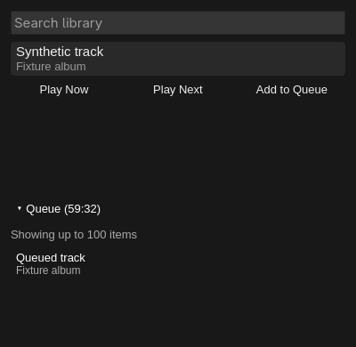

# Using Library, search and queue actions

These additions are intended for wider testing. Tonearm controls your existing
Roon Server; Roon handles local files and streaming services, accounts and audio.
Tonearm does not stream audio itself or require separate TIDAL credentials.

Synthetic component preview; the surrounding popup uses your Omarchy theme.

## Choose an output first

Open Tonearm and click the intended zone name under ZONES. This selects what
Tonearm displays and controls; the cast/transfer icon is a separate operation
that moves existing music. Check the selected zone before using a browse action.
The three action labels are deliberately short: they omit “in <zone>”, but each
request still carries the selected zone identity.

A disconnected or unavailable selected output disables the browse actions.
The selected-output command path refuses a stale target; it does not silently
retarget a pending action to another room. The optional `strict_pins` setting
also controls the existing general missing-pin fallback policy; it still defaults
to false. See [Strict pinning](../README.md#strict-pinning-optional).

Transport, seek, mute and volume controls follow the capabilities Roon reports.
Fixed-volume outputs have no volume slider, and an unavailable operation is not
made available by a presentation default. Desktop media keys continue to use
MPRIS and the selected zone; changing the zone before a queued command dispatch
can cause refusal instead of controlling the new room.

## Browse or search, then choose an action

1. Click **Library** to open categories and browse into Artists, Albums or Tracks,
   or open search using the hint or `/`. Type a query and press Enter.
2. Click a row, press Enter or use Right to open it. Up/Down moves the highlight.
   Previous/Next page controls traverse lists longer than 100 rows. Left goes
   back, preserving the parent page where possible.
3. Highlight the track you want, or highlight an **album row** to request that
   entire album. Merely opening a row does not play it.
4. Click the appropriate short action below the results:

   | Action | Request sent to Roon |
   |---|---|
   | Play Now | Play this track or album now |
   | Play Next | Insert this track or album next in the selected zone's queue |
   | Add to Queue | Append this track or album to the selected zone's queue |

5. Check Now Playing or expand Queue for the result. Each request addresses one
   row, and a whole album uses the album's own Roon action rather than a loop
   over its tracks. The browse cursor clears after an action; navigate/search
   again before another request.

While entering text, Esc leaves the field. Further Esc presses navigate back
through the results, then close the popup. The shell reserves `h j k l x X`
and Space, so use `/` before typing a query that starts with one of those keys.
The letter `q` remains a search letter; there is no queue-add/delete shortcut.

Some rows are categories, some need input or confirmation, and some Core menus
do not offer all actions. Tonearm refuses unsupported prompts/direct action rows
and missing actions; it does not substitute another action. Reload after a stale
view or connection change. If the result is **unknown**, check official Roon
before retrying: the original request might have reached the Core. A “requested”
message does not assert audible playback or a completed queue change.

TIDAL and other streamed recordings may take longer to start than local tracks.
Give Roon time and watch its state before clicking repeatedly. Roon decides what
happens when enqueueing into an empty or stopped queue, including possible audio
start. Select the intended output and keep volume safe when trying these actions.

## Read the queue and its remaining time

Click **Queue** to expand or collapse it. The view follows the selected output,
shows a bounded window of up to 100 items, and refreshes while open. Click or
Up/Down changes its highlight. Enter has no playback action; Esc collapses the
queue before leaving the rest of the popup.

The heading uses Roon's optional whole-queue time: **Queue (59:32)**,
**Queue (1:02:03)**, or **Queue (0:00)**. It follows the existing zone/seek updates,
so it changes during playback and when Roon reports a new queue total. It is not
calculated from the displayed 100 rows. Missing or invalid totals are omitted;
plain **Queue** does not mean the queue is empty. Paused playback should keep the
reported remaining time until another Core update changes it. Repeat/radio future
tracks depend on Roon's reporting; Tonearm does not predict unlimited playback.

## Current limitations

- **One track or one whole album per action.** No Ctrl/Shift multi-selection,
  ranges, multi-album batches or selected-track batch ordering.
- **Queue display and insertion only.** No remove/delete, clear, reorder or
  play-from-here controls, and no keyboard shortcut for them. Use official Roon
  to clean up test additions or edit the queue; Tonearm never clears/rebuilds it
  as a substitute for removal.
- **Bounded view.** Up to 100 queue rows, not scrolling access to an unlimited
  queue. The whole-queue time can include tracks beyond that window.
- **Remote effects are not transactional.** Connection/selection guards reduce
  stale actions, but cannot guarantee remote atomicity or eliminate every
  vendored SDK response/ownership race. Unknown operations are never auto-retried.
- **Not universal acceptance.** Local success does not qualify all hardware,
  themes/scales, Core versions, outage/reconnect patterns or clean installs.
  The optional session-bus mount keeps MPRIS usable within the service sandbox;
  absence of a bus must not prevent ordinary Roon/IPC operation.

Local user reports describe single-song, full-album, TIDAL and local-file use
working, and later successful testing on the Gustard zone as well as iFi.
This is useful user testing, not a repeated device/format matrix or proof that
all queue, timing and reconnect edge cases pass on those endpoints. The compact
row and queue header were also confirmed in the actual popup. The countdown has
synthetic tests; no separately measured live countdown accuracy claim is made.

## Help test and report bugs

Use the PR's head branch for these features; the default released installation
may not contain them until upstream merges/releases. Follow the main README's
installation/setup instructions in a chosen test checkout. Existing users should
keep a known-good code/settings backup, replace their existing Tonearm instance
rather than run a second daemon, and never post pairing/configuration secrets.
No release-version bump or automatic update is part of this contribution.

Useful reports include:

- Tonearm branch/commit, Omarchy/Quickshell and Roon versions.
- Output type/name and whether it was selected, available, paused or playing.
- Local or streaming recording, exact action, track versus album row, and steps.
- Expected result, actual Now Playing/queue result, and any visible error.
- For timing: whether paused, seeking, adding, repeat or radio was involved;
  compare with official Roon. Note if the queue exceeds the 100-row window.
- For UI: popup screenshot, theme, font size and scale, with personal details
  removed. Redact tokens, credentials, private hosts and library details from
  any logs you choose to share.

If an action's result is uncertain, inspect official Roon before repeating it.
Do not clear the queue merely to reproduce a bug; remove only your own test
additions using official Roon.
